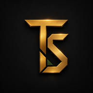

  

<h1 align="center">Turki Al-Salem</h1>

  <b>Full-stack developer · Secure web platforms & automation</b> 
  Founder of <a href="https://nexorify.net">Nexorify</a>

  
  

## About

I build web platforms and business systems with **Laravel** and **PHP**, automate workflows with **Python**, and treat security as part of the design from day one.

أبني منصات ويب وأنظمة أعمال آمنة، وأأتمت العمليات بـ Python.

## Tech stack

  
    
  

## Tools

VS Code · Cursor · Claude Code · Git & GitHub · Laravel Forge

